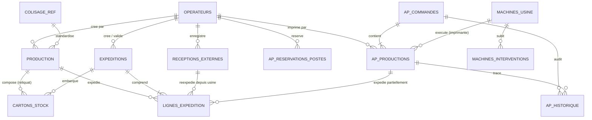

# GEMINI.md — Guide d'Architecture & Référentiel Technique LogiTrak

> **Version de l'application :** 5.0.0  
> **Contexte opérationnel :** Eurequat Algérie — Usine de Tlemcen  
> **Dernière mise à jour :** Février 2026 / Version stable v5.0.0  
> **Auteur & Conception :** Boumediene (© 2026 Eurequat Algérie)

---

## 1. Vue d'Ensemble du Projet

**LogiTrak** est l'application industrielle web et PWA (Progressive Web App) conçue sur mesure pour piloter l'ensemble du cycle de production, de conditionnement et d'expédition de l'usine **Eurequat Algérie à Tlemcen**.

### 1.1 Objectifs Métier
1. **Pilotage de la Production :** Suivi en temps réel des Ordres de Fabrication (OF), gestion des lots, saisie des quantités produites par catégorie (étiquettes adhésives, étiquettes RFID, rubans de transfert thermique TTR, cartes PVC, tags).
2. **Colisage Industriel & Normalisation :** Calcul automatisé du nombre de cartons selon les capacités des produits, application des tares normalisées (cartons H1 et H2), contrôle strict du poids maximal autorisé (15 kg/carton), et arbitrage formel des reliquats de production (carton partiel vs mise en stock pour cartons mixtes).
3. **Gestion des Expéditions (Envois) :** Création et validation administrative des expéditions, génération des bordereaux de livraison (BL), gestion des transporteurs, réservation immédiate des stocks, et partage multi-canal (impression, WhatsApp, Email, export CSV).
4. **Module Dédié Algérie Poste :** Gestion intégrale du flux de fabrication des étiquettes à code-barres Algérie Poste (commandes UPW avec numérotation unique immuable `APN`, réservation des postes de travail, répartition sur les imprimantes dédiées, contrôle séquentiel strict des plages d'identifiants, cadence d'impression, et traçabilité inaltérable avec journal d'audit).
5. **Parc Machines & Maintenance :** Registre exhaustif des machines de découpe, d'impression et de façonnage, suivi des interventions préventives et correctives, alertes de maintenance.
6. **Statistiques & Reporting :** Tableaux de bord consolidés de la production et des expéditions arrêtés à la date civile locale d'Algérie, répartition par catégorie de produit et classement des destinataires.

---

## 2. Architecture Technique & Pile Technologique

Le projet adopte une architecture **Jamstack / BaaS ultra-légère, résiliente et sans étape de compilation (Zero-Build)**, privilégiant la rapidité de chargement, l'autonomie sur le réseau local/web et une maintenance facilitée directement dans les navigateurs modernes.

### 2.1 Front-End
- **Langage :** Vanilla JavaScript (ES2020+ / ES Modules / Scripts isolés par IIFE).
  - Aucune dépendance à un framework lourd (pas de Node.js, React, Vue, ni Angular en runtime de build).
  - Compatibilité native assurée avec Google Chrome et Microsoft Edge (Desktop & Mobile).
- **Feuilles de Styles & UI :**
  - **Tailwind CSS (via CDN) :** Version script injectée dynamiquement (`https://cdn.tailwindcss.com`) avec configuration dédiée dans [js/tailwind-config.js](file:///E:/Devlop/Gemini/logitrak4.0.25/js/tailwind-config.js).
  - **CSS Custom [css/style.css](file:///E:/Devlop/Gemini/logitrak4.0.25/css/style.css) :** Thématique moderne et dynamique basée sur les couleurs officielles d'Eurequat (Bleu Azur `#0284c7`, Cyan Électrique, Orange Solaire `#ea580c`), design permanent clair lumineux (thème sombre totalement retiré), micro-interactions réactives, variables CSS (`--bg`, `--accent`, `--primary`, `--module-*`), modales, formulaires ergonomiques, badges, et règles d'impression papier dédiées (`@media print`).
  - **Iconographie :** FontAwesome 6.5.1 Pro/Free (CDN Cloudflare).
  - **Typographies :** Google Fonts (`Plus Jakarta Sans` en typographie principale haute lisibilité et `JetBrains Mono` pour les numéros de série, identifiants et codes-barres).
- **Visualisation de Données :** Chart.js (CDN jsDelivr) pour les graphiques de production et d'expédition mensuels.
- **Acquisition Caméra & Codes-Barres :**
  - API native `BarcodeDetector` du navigateur combinée à la bibliothèque **ZXing** (`@zxing/library@0.21.3` chargée à la demande via CDN) pour scanner en direct codes-barres 1D (Code 128, EAN-13), QR Codes et DataMatrix dans [js/scanner.js](file:///E:/Devlop/Gemini/logitrak4.0.25/js/scanner.js).

### 2.2 Back-End & Base de Données (BaaS)
- **Plateforme :** **Supabase** (PostgreSQL 15+).
- **Client :** `@supabase/supabase-js@2` (chargé via CDN jsDelivr).
- **Configuration (`config.js`) :**
  - Contient l'URL Supabase et la clé publique `anon`. Ces valeurs sont exposées en clair dans le code source JavaScript côté client. C'est **sans danger uniquement parce que la RLS est activée sur 100 % des tables** (cf. `setup.sql` + `security-hardening.sql`). **Ne jamais désactiver la RLS.**
  - Les administrateurs peuvent surcharger URL et clé via `localStorage` (clés `supabase_url` et `supabase_key`) sans modifier le fichier source.
- **Sécurité & Contrôle d'Accès (RLS) :**
  - Row Level Security (RLS) activé sur **100 % des tables**.
  - Fonctions de filtrage stables `is_operator()`, `is_admin()`, `is_visionnaire()`.
  - Résolution de l'identité via le JWT Supabase : `get_username() = split_part(lower(auth.jwt() ->> 'email'), '@', 1)`.
- **Logique Serveur & Intégrité des Données :**
  - Triggers et fonctions stockées écrites en **PL/pgSQL**.
  - Verrous transactionnels préventifs (`pg_advisory_xact_lock`) pour empêcher les collisions lors de la génération de séquences, de la réservation des postes ou de la validation concurrente de cartons.
  - Procédures de hachage de mots de passe cryptographiques via l'extension `pgcrypto`.

### 2.3 PWA (Progressive Web App) & Stratégie Offline
- **Manifeste d'application :** [manifest.webmanifest](file:///E:/Devlop/Gemini/logitrak4.0.25/manifest.webmanifest) (icônes 192px, 512px, maskable, raccourcis d'application, thème `#14395f`, affichage `standalone`).
- **Service Worker :** [sw.js](file:///E:/Devlop/Gemini/logitrak4.0.25/sw.js) (Version `4.0.25`).
- **Gestionnaire PWA client :** [js/pwa.js](file:///E:/Devlop/Gemini/logitrak4.0.25/js/pwa.js) (installation Windows/Android, dialogue d'aide, notification et validation des mises à jour `ACTIVATE_UPDATE`).
- **Politique de Cache (Network-First strict pour les données) :**
  - Les requêtes API et données Supabase ne sont **jamais mises en cache** par le Service Worker afin de garantir une intégrité parfaite des stocks et éviter les collisions multi-postes.
  - En cas de rupture réseau, redirection vers [offline.html](file:///E:/Devlop/Gemini/logitrak4.0.25/offline.html).

---

## 3. Structure Détaillée des Fichiers

```
logitrak4.0.25/
├── assets/                               # Ressources graphiques et icônes
│   ├── app-icon-192.png                  # Icône PWA 192x192
│   ├── app-icon-512.png                  # Icône PWA 512x512
│   ├── app-icon-maskable-512.png         # Icône Android adaptable
│   ├── favicon.ico                       # Favicon multi-résolution
│   └── logitrak-eurequat.jpg             # Logo officiel haute définition
├── css/
│   └── style.css                         # Styles maîtres, thèmes Dark/Light, impression
├── js/                                   # Logique applicative JavaScript
│   ├── algerie-poste.js                  # Logique UI/Métier module Algérie Poste
│   ├── ap-calc.js                        # Calculs de plages et découpage ID Algérie Poste
│   ├── ap-packing.js                     # Colisage par commande et étiquettes AP
│   ├── ap-products.js                    # Référentiel des types de produits Algérie Poste
│   ├── ap-trace.js                       # Moteur de recherche et traçabilité des tirages AP
│   ├── app.js                            # Logique principale du module Envois & Expéditions
│   ├── calendar.js                       # Gestion de la date civile Algérie (Africa/Algiers)
│   ├── cartons-stock.js                  # Gestion des cartons physiques composés en stock
│   ├── colisage-calc.js                  # Cœur de calcul du colisage industriel (H1, H2, reliquats)
│   ├── config.js                         # Configuration Supabase URL & clé publique anon
│   ├── data-pages.js                     # Pagination et lecture continue des tables Supabase
│   ├── embed.js                          # Intégration en iframe sécurisée de portails externes
│   ├── listes.js                         # Gestionnaire des listes configurables par l'administrateur
│   ├── machines.js                       # Gestion du parc machines et comptes utilisateurs
│   ├── nav.js                            # Barre de navigation, statuts, rôles et badges temps réel
│   ├── print-document.js                 # Décodage d'images garanti avant impression
│   ├── product-reference.js              # Analyseur de références produits et badges visuels
│   ├── pwa.js                            # Gestion de l'installation et des mises à jour PWA
│   ├── reliquat.js                       # Dialogue modal d'arbitrage de reliquat de production
│   ├── scanner.js                        # Scanner de codes-barres / QR / DataMatrix par caméra
│   └── tailwind-config.js                # Configuration locale de Tailwind CSS
├── sql/                                  # Scripts d'initialisation et migrations Supabase
│   ├── setup.sql                         # Schéma initial de base, RLS et rôles
│   ├── production.sql                    # Module production & colisage v2
│   ├── security-hardening.sql            # Durcissement RLS et isolation
│   ├── v18-listes-et-verrous.sql         # Verrouillage OF/BL et listes administrables
│   ├── v21-colisage-reference.sql        # Fiches colisage par référence et reliquats
│   ├── v22-validation-envois.sql         # Workflow de validation des envois par admin
│   ├── v23-clients-cartons-stock.sql     # Cartons composés en stock et clients par lot
│   ├── v32-algerie-poste.sql             # Base du module Algérie Poste
│   ├── v321-plages-algerie-poste.sql     # Contrôle renforcé des plages d'ID
│   ├── v37-tracabilite-algerie-poste.sql # Historique d'audit inaltérable AP
│   ├── v371-commandes-algerie-poste.sql  # Typologie des produits et commandes AP
│   ├── v372-colisage-algerie-poste.sql   # Colisage normé Algérie Poste
│   ├── v374-declaration-algerie-poste.sql# Réservation de tirage depuis la production
│   ├── v38-flux-algerie-poste.sql        # Suivi multi-machines par opérateur
│   ├── v383-envois-partiels-algerie-poste.sql # Expéditions partielles tirages AP
│   ├── v385-algerie-poste-commandes-impression.sql # Numérotation séquentielle APN
│   ├── v394-machines-apn.sql             # Registre des machines usine & imprimantes AP
│   ├── v398-parametres.sql               # Paramétrage avancé et nettoyages
│   ├── v3910-suppression-utilisateur.sql # Fonction sécurisée de suppression d'opérateur
│   ├── v3911-visionnaire.sql             # Rôle en lecture seule "visionnaire"
│   ├── v401-gestion-utilisateurs.sql     # Création et édition de comptes via pgcrypto
│   ├── v407-delai-24h.sql                # Harmonisation du délai de modification à 24h
│   ├── v409-regroupement-h2.sql          # Option de regroupement des reliquats en carton H2
│   ├── v4012-flux-ap.sql                 # Verrouillage postes de travail et cadences AP
│   ├── v4015-reservation-postes.sql      # Système d'attribution exclusive des postes
│   ├── v4020-commandes-ap.sql            # Contrôle de fin de commande avant réouverture
│   ├── v4027-receptions-et-stock.sql     # Réceptions externes, retours clients et stock usine
│   ├── v4028-branding.sql                # Identité visuelle, logo et slogan personnalisables
│   ├── v500-correctifs-envois-et-cartons.sql # Correctifs lecture envois, cartons mixtes & save_expedition
│   └── optionnel-lecture-visiteurs.sql   # Déverrouillage optionnel en lecture publique
├── algerie-poste.html                    # Interface du module Algérie Poste
├── colisage.html                         # Interface des fiches de colisage et préparation
├── envois.html                           # Interface de gestion des expéditions et BL
├── index.html                            # Tableau de bord d'accueil et indicateurs clés (KPI)
├── INSTALLATION-WINDOWS-ANDROID.md       # Manuel d'installation PWA et déploiement
├── login.html                            # Interface d'authentification dédiée ultra-rapide (REST)
├── machines.html                         # Interface Registre Machines & Paramètres admin
├── manifest.webmanifest                  # Manifeste PWA
├── offline.html                          # Page de secours hors-ligne
├── pointage.html                         # Interface intégrée du portail de pointage Eurequat
├── production.html                       # Interface du suivi de fabrication et des OF
├── README.md                             # Historique des versions et documentation générale
├── statistiques.html                     # Tableau de bord analytique et graphiques
└── sw.js                                 # Service Worker PWA
```

---

## 4. Modèle de Données & Base Supabase

### 4.1 Entités Principales

| Table | Description | Clé Primaire | Index Clés & Dépendances |
|---|---|---|---|
| `operateurs` | Utilisateurs applicatifs (`admin`, `operateur`, `visionnaire`). | `username` (text) | Lié à `auth.users` par `username@logitrak.internal`. |
| `production` | Lots de fabrication rattachés aux OF. | `id` (uuid) | `of_numero`, `reference`, `client`, `colisage_ref_id`. |
| `colisage_ref` | Fiches techniques de référence (conditionnement type). | `id` (uuid) | Index unique sur `upper(reference)`. |
| `cartons_stock` | Cartons composés physiques en attente d'expédition. | `id` (uuid) | `expedition_id`, `revision` (concurrence optimiste). |
| `expeditions` | Bordereaux d'expédition / BL. | `id` (uuid) | `date_envoi`, `numero_bl`, `validation`. |
| `lignes_expedition` | Lignes de détail d'un envoi (lots, quantités, colis). | `id` (uuid) | `expedition_id`, `production_id`, `ap_production_id`, `reception_id`. |
| `receptions_externes` | Marchandises reçues de l'extérieur ou retours clients destinés à être réexpédiés depuis l'usine. | `id` (uuid) | `numero_reception`, `type_entree`, `upper(reference)`, `date_reception`. |
| `ap_commandes` | Commandes client d'Algérie Poste (UPW). | `id` (uuid) | `numero_ap` (généré via séquence `ap_commande_num_seq`). |
| `ap_productions` | Tirages d'impression Algérie Poste (plages d'ID). | `id` (uuid) | `commande_id`, `poste_travail`, `imprimante`, `statut`. |
| `ap_historique` | Journal d'audit immuable des événements AP. | `id` (uuid) | `commande_id`, `production_id`, `created_at`. |
| `ap_reservations_postes` | Verrouillage exclusif des postes opérateur AP. | `poste` (text) | `Poste01`, `Poste02`, clé étrangère implicite `operateur`. |
| `ap_notifications` | Alertes entre opérateurs lors de tirages concurrents. | `id` (uuid) | `destinataire`, `commande_id`. |
| `machines_usine` | Registre physique des machines de l'usine. | `id` (uuid) | Index unique sur `nom` (en majuscules). |
| `machines_interventions`| Historique des maintenances et réparations. | `id` (uuid) | `machine_id`, `date_intervention`. |
| `parametres` | Listes de valeurs gérées par l'admin (JSON). | `cle` (text) | `categories`, `unites`, `types_carton`. |

### 4.2 Schéma Relationnel & Flux Métier (Mermaid)



---

## 5. Règles Métier & Logique Applicative

### 5.1 Rôles et Habilitations (RBAC) & Verrouillage d'Accès Strict (Anti-Visionnage)
> **Politique d'Accès Strict & Page Dédiée `login.html` :** L'application est protégée par une redirection synchrone immédiate (0 ms) dans `<head>`. Tout accès invité ou mode consultation publique / visionnaire a été éliminé. Aucun module ni donnée n'est accessible sans authentification préalable via [login.html](file:///E:/Devlop/Gemini/logitrak4.0.25/login.html). L'authentification utilise un appel direct REST à l'API Supabase Auth (`POST /auth/v1/token?grant_type=password`) sans blocage CDN ni verrou de concurrence `navigator.locks`, garantissant une vitesse d'affichage et de connexion instantanée (< 400 ms).

1. **Administrateur (`admin`) :**
   - Validation définitive des expéditions (`VALIDE`).
   - Modification ou suppression de n'importe quel enregistrement sans limite de temps.
   - Création, modification et suppression des comptes utilisateurs (`create_operator`, `edit_logitrak_operator`, `delete_logitrak_operator`).
   - Gestion des fiches machines et interventions.
   - Paramétrage des listes maîtresses (catégories, unités, types de cartons) via [js/listes.js](file:///E:/Devlop/Gemini/logitrak4.0.25/js/listes.js).
   - Dérogations exceptionnelles : dépassement de poids de carton (> 15 kg), réouverture de commandes AP bloquées.
2. **Opérateur (`operateur`) :**
   - Saisie des lots de production et décision des reliquats.
   - Composition des cartons en stock.
   - Préparation des nouveaux envois (statut initial : `A_VALIDER`).
   - Saisie des tirages et validation des plages d'impression Algérie Poste.
   - **Règle stricte des 24 heures :** Un opérateur ne peut modifier ou supprimer ses propres saisies (envois, production, tirages AP) que durant les **24 heures** suivant leur création. Au-delà, l'intervention d'un administrateur est requise.

### 5.2 Règles de Conditionnement & Colisage Industriel ([js/colisage-calc.js](file:///E:/Devlop/Gemini/logitrak4.0.25/js/colisage-calc.js))
- **Types de Cartons et Tares normalisées :**
  - **H1 :** Tare vide = **`0,420 kg`** (utilisé pour les petits volumes ou reliquats).
  - **H2 :** Tare vide = **`0,465 kg`** (carton standard haute capacité).
- **Limite de Poids :** Tout carton complet (tare + contenu) a une limite maximale stricte de **`15,000 kg`** pour respecter les normes de manutention et de sécurité. Une alerte rouge s'affiche en cas de dépassement.
- **Gestion des Reliquats (`reliquat_mode`) :**
  - Si `quantité produite % qpc > 0`, un reliquat existe.
  - L'opérateur **doit** obligatoirement arbitrer avant qu'un lot ne puisse être expédié :
    1. **`CARTON` :** Le reliquat est mis dans un carton partiel dédié (H1 ou H2 au choix) et comptabilisé dans le colisage du lot.
    2. **`STOCK` :** Le reliquat reste en stock vrac pour être combiné plus tard dans un **Carton Mixte** via le sous-module [js/cartons-stock.js](file:///E:/Devlop/Gemini/logitrak4.0.25/js/cartons-stock.js).
- **Cartons Mixtes en Stock (`cartons_stock`) :**
  - Permet d'associer plusieurs reliquats de références distinctes dans un seul carton physique (numéroté par son UUID court).
  - Vérification transactionnelle des reliquats disponibles et contrôle du poids total cumulé.

### 5.3 Cycle de Validation & Numérotation des Expéditions
- **Format Normalisé des Envois :** `ENV{YY}{MM}-{XXXX}` (ex: `ENV2611-0001`, `ENV2611-0002` avec l'année sur 2 chiffres et le mois sur 2 chiffres).
- **Immuabilité du Numéro :** Le numéro d'envoi est auto-généré par PostgreSQL (`save_expedition`) et est strictement inchangeable pour les opérateurs. Seul un administrateur peut modifier manuellement le numéro d'envoi.
- Tout nouvel envoi créé par un opérateur a le statut `validation = 'A_VALIDER'`.
- Un envoi `A_VALIDER` **réserve immédiatement les quantités** en stock (pour éviter toute double expédition d'une même bobine), mais n'est comptabilisé ni dans les statistiques officielles ni dans les compteurs d'accueil.
- Un **badge d'alerte rouge** dans la barre de navigation ([js/nav.js](file:///E:/Devlop/Gemini/AGY/logitrak4.0.25/js/nav.js)) prévient les administrateurs du nombre d'envois en attente.
- Seul un administrateur peut cliquer sur **Valider** (statut `VALIDE`), ce qui verrouille définitivement l'envoi pour les opérateurs et fige la copie du colisage dans `colisage_detail` (JSONB).

### 5.4 Règles Spécifiques Algérie Poste ([js/algerie-poste.js](file:///E:/Devlop/Gemini/logitrak4.0.25/js/algerie-poste.js))
1. **Types de Produits :**
   - `N_RR` : National · RR — Lettres recommandées (3 ex, 85 × 54 mm, réf `E02CW25P1`, H1 = 14 000 ID, 0,750 kg/paquet).
   - `N_CP` : National · CP — Courriers postaux (3 ex, 85 × 54 mm, réf `E02CW25P1`, H1 = 14 000 ID, 0,750 kg/paquet).
   - `N_GC` : National · GC — Grand Compte (2 ex, 85 × 36 mm, réf `E02CV25P1`, H1 = 20 000 ID, 0,500 kg/paquet).
   - `I_RR` : International · RR (3 ex, 85 × 54 mm, réf `E02CW25P1`, H1 = 14 000 ID, 0,750 kg/paquet).
   - `I_CP` : International · CP (3 ex, 85 × 54 mm, réf `E02CW25P1`, H1 = 14 000 ID, 0,750 kg/paquet).
2. **Numérotation et Plages d'ID :**
   - Chaque commande reçoit un numéro unique `APN : 0001` auto-généré par la base.
   - Les identifiants sont au format 8 chiffres (ex : `00 378 601`).
   - La fonction trigger `ap_plage_guard()` empêche tout chevauchement de numéros pour une même commande.
3. **Organisation des Postes & Cadence d'Impression :**
   - Deux postes physiques déclarés : `Poste01` (imprimantes `IMP01` à `IMP04`) et `Poste02` (`IMP05` et `IMP06`).
   - Un opérateur doit réserver son poste (`ap_reservations_postes`) avant de lancer un tirage.
   - **Cooldown de sécurité :** Un délai obligatoire de **5 minutes** est imposé entre deux validations consécutives sur la même imprimante (`ap_z_workstation_guard`).
   - Un opérateur ne peut pas créer une nouvelle commande s'il a encore une commande en cours non terminée, sauf autorisation expresse d'un administrateur (`autorise_nouvelle_commande`).
   - **Synchronisation horloge serveur :** Au chargement du module, `syncAPClock()` appelle le RPC `ap_server_time_ms()` pour aligner l'horloge locale sur le serveur Supabase. Toutes les vérifications de délai côté interface (`apNow()`) utilisent cette base de temps synchronisée pour être cohérentes avec les triggers BDD.
5. **Option Regroupement H2 (`regroupement_h2`) :**
   - Champ `boolean` sur `ap_commandes` (ajouté dans `v409-regroupement-h2.sql`).
   - Lorsqu'activé, le dernier carton H1 partiel est fusionné avec le précédent carton H1 plein pour former un carton H2 unique. Logique implémentée dans la fonction `apCartons()` de [js/ap-products.js](file:///E:/Devlop/Gemini/logitrak4.0.25/js/ap-products.js).
   - Seul un administrateur peut activer cette option (via la vue commande dans le module Algérie Poste).
6. **Journal d'Audit Immuable (`ap_historique`) :**
   - Enregistrement automatique de tout événement (démarrage, validation, modification, réouverture, suppression) avec état avant / état après en JSON, auteur, horodatage serveur et commande liée.
   - Les enregistrements de cette table ne peuvent être ni altérés ni supprimés.

### 5.5 Gestion du Stock de Production, Réceptions Externes & Retours Clients (v4.0.27)
1. **Stock de Production Consolidé (`production.html` onglet « Stock de Production ») :**
   - Agrégation temps réel par référence de l'ensemble des lots de fabrication (OF) et des réceptions externes / retours clients.
   - Calcul de la disponibilité nette : `stock_dispo = total_produit - expedie_valide - reserve_bl` (en tenant compte des réservations immédiates par les envois en statut `A_VALIDER`).
   - Estimation dynamique du nombre de cartons pleins prêts à l'expédition selon la capacité standard de la fiche colisage (`qte_par_carton`).
   - Filtres interactifs par catégorie, disponibilité (`En stock (>0)`, `Tout voir`, `Réservé`, `Soldé (0)`), recherche textuelle multi-colonnes, export CSV normé et impression de l'état d'inventaire usine.
2. **Réceptions Externes & Retours Clients (`receptions_externes`) :**
   - Enregistrement des produits confectionnés ailleurs ou provenant d'autres sites (`RECEPTION`), ainsi que des retours clients pour SAV ou réexpédition (`RETOUR`).
   - Numérotation séquentielle automatique mensuelle : `RECYYMM-xxxx` ou `RETYYMM-xxxx`.
   - Spécification de la provenance, de la référence, de la désignation, du conditionnement (cartons H1/H2/palette/vrac) et du client réservé éventuel.
   - **Expédition depuis l'usine :**
     - Sélectionnable dans le sélecteur d'articles du module Expéditions (`#prodPickerModal`), avec affichage du stock restant et badges distinctifs.
     - Bouton d'action directe « Expédier depuis l'usine » redirigeant vers `envois.html?new=1&reception=ID` pour pré-remplir instantanément la ligne d'envoi.
     - Liaison garantie par le trigger BDD `trg_lignes_expedition_reception` qui alimente automatiquement la clé étrangère `lignes_expedition(reception_id)` depuis `colisage_detail` JSONB.
   - Respect de la règle stricte des 24h pour les opérateurs et accès sans restriction pour les administrateurs.

---

## 6. Règles de Code & Bonnes Pratiques de Développement

Pour assurer la maintenabilité, la pérennité et la compatibilité du projet, tout développement ou modification de code doit se conformer strictement aux directives suivantes :

### 6.1 JavaScript Client
- **Zéro Dépendance de Compilation :** N'ajoutez aucun bundler (Webpack, Vite, Rollup, Babel). Les scripts doivent pouvoir être exécutés tels quels par le navigateur.
- **Isolation de Portée (Scoping) :** Encapsulez le code de chaque script dans une IIFE `(function () { 'use strict'; ... })();` afin de ne pas polluer l'objet global `window`.
- **Objets Globaux Partagés Reconnus :**
  - Seuls les utilitaires transverses ont vocation à être exportés sur `window` :
    - `window.LTColis` : Moteur de calcul du colisage ([js/colisage-calc.js](file:///E:/Devlop/Gemini/logitrak4.0.25/js/colisage-calc.js)).
    - `window.APcalc` / `window.APproducts` / `window.APtrace` : Métier Algérie Poste.
    - `window.LTReliquat` : Dialogue d'arbitrage de reliquat ([js/reliquat.js](file:///E:/Devlop/Gemini/logitrak4.0.25/js/reliquat.js)).
    - `window.productReference` / `window.renderReferenceBadges` : Décodage des badges de référence.
    - `window.Listes` : Gestionnaire des listes admin ([js/listes.js](file:///E:/Devlop/Gemini/logitrak4.0.25/js/listes.js)) — API : `Listes.get(key)`, `Listes.bind(el, key, opts)`, `Listes.setValue(el, v)`, `Listes.init(client, admin)`, `Listes.onChange(fn)`.
    - `window.LTNavRefreshPending(n)` : Mise à jour du badge rouge d'envois à valider, appelable depuis n'importe quelle page ([js/nav.js](file:///E:/Devlop/Gemini/logitrak4.0.25/js/nav.js)).
    - `window.openExpeditionModal()` : Ouverture de la modale « Nouvel envoi » depuis la barre de navigation ou toute autre page (implémenté dans [js/app.js](file:///E:/Devlop/Gemini/logitrak4.0.25/js/app.js) sur `envois.html`, déclenché par `nav.js`).
    - `window.openAdmin()` : Ouverture du panneau de configuration admin (connexion Supabase, gestion opérateurs).
    - `window.authAction()` : Délégation de l'action connexion/déconnexion au module actif de la page.
    - `window.confirmDialog(msg)` : Boîte de dialogue de confirmation asynchrone (Promise). Si non disponible, `nav.js` utilise `window.confirm()` en fallback.
- **Exceptions à la règle IIFE :**
  - Les scripts **pages complètes** (`app.js`, `algerie-poste.js`, `cartons-stock.js`, `machines.js`) ne sont **pas** encapsulés dans une IIFE. Ils sont le seul script métier chargé sur leur page respective et exposent intentionnellement leurs fonctions au scope global pour permettre les liaisons `onclick` HTML inline et les appels inter-scripts de la même page.
  - Cette exception est délibérée et documentée. Ne pas tenter de les envelopper dans une IIFE sans refactoriser tous les handlers HTML inline.
- **Sécurité & Protection XSS :**
  - **Ne jamais** injecter de variables brutes dans `innerHTML`.
  - Utilisez toujours la fonction d'échappement universelle :
    ```javascript
    const esc = v => String(v ?? '').replace(/[&<>"']/g, c => ({
      '&': '&amp;', '<': '&lt;', '>': '&gt;', '"': '&quot;', "'": '&#39;'
    }[c]));
    ```
- **Gestion des Dates et Fuseaux Horaires :**
  - **Ne jamais** utiliser `new Date().toISOString().slice(0, 10)` pour les dates de production (risque de décalage d'un jour en fin de journée par rapport à UTC).
  - Utilisez toujours la fonction standardisée `logitrakToday()` définie dans [js/calendar.js](file:///E:/Devlop/Gemini/logitrak4.0.25/js/calendar.js), alignée sur le fuseau officiel de l'usine : `timeZone: 'Africa/Algiers'`.
- **Lecture Performante des Données (Pagination) :**
  - Supabase limite les requêtes REST à 1 000 lignes par défaut.
  - Utilisez impérativement `readLogiTrakRows(client, table, columns)` ([js/data-pages.js](file:///E:/Devlop/Gemini/logitrak4.0.25/js/data-pages.js)) pour charger de façon ordonnée et sans rupture les historiques de données dépassant 1 000 enregistrements.
- **Expérience Utilisateur Non-Bloquante :**
  - Bannir l'usage de `alert()` dans les flux opérationnels normaux ; privilégier `toast(message, 'success'|'error'|'warning')`.
  - Pour les suppressions ou actions critiques, utiliser la promesse modale personnalisée `confirmDialog(message)`.

### 6.2 SQL & Base de Données Supabase
- **Idempotence Obligatoire :** Tous les scripts dans `sql/` doivent pouvoir être ré-exécutés plusieurs fois sans échec :
  - `CREATE TABLE IF NOT EXISTS ...`
  - `ALTER TABLE ... ADD COLUMN IF NOT EXISTS ...`
  - `DROP POLICY IF EXISTS ...` suivi de `CREATE POLICY ...`
- **Sécurité des Fonctions PL/pgSQL :**
  - Définir `SECURITY DEFINER` uniquement lorsque des privilèges élevés sont nécessaires (ex : contourner temporairement une restriction RLS pour un trigger d'audit).
  - Toujours fixer explicitement le search path pour se prémunir du *search-path hijacking* :
    ```sql
    SET search_path = '' (ou SET search_path = public)
    ```
- **Concurrence & Verrous (Advisory Locks) :**
  - Lors des opérations critiques à risque de course critique (génération de numéros séquentiels, réservation de poste, mise en stock d'un reliquat), poser un verrou consultatif de transaction :
    ```sql
    PERFORM pg_catalog.pg_advisory_xact_lock(...);
    ```
- **Concurrence Optimiste (`revision`) :**
  - Le champ `revision uuid` sur la table `cartons_stock` implémente un pattern de **verrouillage optimiste** : la fonction `save_carton_stock()` vérifie que la `revision` passée par le client correspond exactement à celle stockée en base. Si un autre poste a modifié le carton entre la lecture et la sauvegarde, l'opération échoue avec un message d'erreur explicite (`Ce carton a changé ou a été expédié. Rechargez le stock.`). Côté JS, on passe toujours `box.revision` lors de l'appel RPC.
- **Actualisation du Cache PostgREST :**
  - Toujours terminer les scripts modifiant la structure des tables ou les fonctions par :
    ```sql
    NOTIFY pgrst, 'reload schema';
    COMMIT;
    ```

### 6.3 Pattern `data-module` (Thème & Navigation)

Chaque page HTML porte un attribut `<body data-module="...">` qui remplit **trois rôles simultanés** :

1. **Thème CSS par module :** Les variables `--module` et `--module-bg` dans [css/style.css](file:///E:/Devlop/Gemini/logitrak4.0.25/css/style.css) sont surchargées selon la valeur de `data-module`, donnant à chaque section sa couleur d'accentuation distinctive. Les sélecteurs `.hub-card[data-module]`, `.page-heading` et `[data-module] i` s'appuient directement sur cet attribut.
2. **Activation du lien de navigation :** Dans [js/nav.js](file:///E:/Devlop/Gemini/logitrak4.0.25/js/nav.js), `document.body.dataset.module` est comparé à chaque entrée de menu pour poser la classe CSS `active` sur le bon onglet.
3. **Routage conditionnel :** Certains comportements (badge envois, connexion/déconnexion) sont conditionnés à la valeur du module courant.

| Valeur `data-module` | Page associée |
|---|---|
| `index` | [index.html](file:///E:/Devlop/Gemini/logitrak4.0.25/index.html) — Tableau de bord KPI |
| `production` | [production.html](file:///E:/Devlop/Gemini/logitrak4.0.25/production.html) — Suivi OF |
| `colisage` | [colisage.html](file:///E:/Devlop/Gemini/logitrak4.0.25/colisage.html) — Fiches de conditionnement |
| `envois` | [envois.html](file:///E:/Devlop/Gemini/logitrak4.0.25/envois.html) — Expéditions & BL |
| `algerie-poste` | [algerie-poste.html](file:///E:/Devlop/Gemini/logitrak4.0.25/algerie-poste.html) — Module AP |
| `statistiques` | [statistiques.html](file:///E:/Devlop/Gemini/logitrak4.0.25/statistiques.html) — Analytique |
| `machines` | [machines.html](file:///E:/Devlop/Gemini/logitrak4.0.25/machines.html) — Parc machines & admin |
| `pointage` | [pointage.html](file:///E:/Devlop/Gemini/logitrak4.0.25/pointage.html) — Portail de pointage |

> **Règle :** Ne jamais omettre cet attribut sur `<body>` lors de la création d'une nouvelle page. Choisir une valeur cohérente avec les entrées déclarées dans `nav.js`.

### 6.4 CSS & Ergonomie Visuelle
- **Contrats de Couleurs & Thème :**
  - Respecter scrupuleusement la charte de couleurs via les variables CSS :
    - Bleu Marine Fond : `--bg: #0b1829` (sombre) / `#f0f5fa` (clair).
    - Cyan / Bleu Électrique : `--accent: #00b4d8` (sombre) / `#0284c7` (clair).
    - Orange Eurequat : `--primary: #ff7a00` (sombre) / `#f26400` (clair).
  - Assurer la lisibilité immédiate dans les deux thèmes (`html` vs `html.light`).
- **Support Impression Papier (@media print) :**
  - Les bordereaux de livraison (BL), fiches de colisage et étiquettes AP doivent s'imprimer parfaitement en noir & blanc ou couleur sur format A4.
  - Masquer systématiquement la navigation et les contrôles avec la classe `.no-print`.
  - Forcer la fidélité des couleurs : `-webkit-print-color-adjust: exact; print-color-adjust: exact;`.
  - Avant tout appel à `window.print()`, appeler `printLogiTrakDocument(root)` ([js/print-document.js](file:///E:/Devlop/Gemini/logitrak4.0.25/js/print-document.js)) afin de garantir le pré-chargement et le décodage du logo JPG officiel.

---

## 7. Procédure de Déploiement & Maintenance

### 7.1 Déploiement Client (Web & HTTPS)
1. Téléverser l'intégralité du répertoire sur un hébergement web supportant le protocole **HTTPS** (obligatoire pour le Service Worker, l'installation PWA et l'accès à la caméra du scanner).
2. S'assurer que le fichier [manifest.webmanifest](file:///E:/Devlop/Gemini/logitrak4.0.25/manifest.webmanifest) est servi avec le type MIME `application/manifest+json`.
3. S'assurer que [sw.js](file:///E:/Devlop/Gemini/logitrak4.0.25/sw.js) se trouve **à la racine du domaine ou du sous-dossier de publication** afin de couvrir tout le scope de l'application.

### 7.2 Cache-Busting des Scripts

Les balises `<script>` dans les fichiers HTML utilisent un suffixe `?v=` pour forcer le rechargement des scripts modifiés par les navigateurs et le Service Worker :

```html
<script src="js/nav.js?v=4.0.23"></script>
```

> **Règle :** Mettre à jour le suffixe `?v=` d'un fichier JS **à chaque release qui modifie ce fichier**. Ne pas incrémenter les versions des fichiers non touchés. La version dans le suffixe n'a pas besoin de correspondre exactement à la version applicative — elle sert uniquement à invalider le cache.

### 7.3 Raccourcis PWA (Manifest)

Le fichier [manifest.webmanifest](file:///E:/Devlop/Gemini/logitrak4.0.25/manifest.webmanifest) déclare 3 raccourcis d'application visibles sur l'écran d'accueil Android / menu contextuel Windows :

| Raccourci | URL | Icône |
|---|---|---|
| Production | `production.html` | Icône module production |
| Envois | `envois.html` | Icône module envois |
| Algérie Poste | `algerie-poste.html` | Icône module AP |

### 7.4 Accès Administrateur Caché

Dans [js/nav.js](file:///E:/Devlop/Gemini/logitrak4.0.25/js/nav.js), un **double-clic sur le logo** (`#appBrandLogo`) déclenche `window.openAdmin()` si et seulement si l'utilisateur connecté est admin. Ce mécanisme permet d'accéder au panneau de configuration Supabase (URL/clé) et à la gestion des opérateurs **sans exposer de bouton visible dans l'interface**.

> **Important :** Ne pas supprimer ce handler dans `nav.js`. C'est le seul point d'entrée de l'interface d'administration sur toutes les pages sauf `machines.html`.

### 7.5 Mode Offline Dégradé (Fallback localStorage)

En cas d'indisponibilité de Supabase, [index.html](file:///E:/Devlop/Gemini/logitrak4.0.25/index.html) et [js/app.js](file:///E:/Devlop/Gemini/logitrak4.0.25/js/app.js) lisent le cache local `eurequat_expeditions_v1` depuis `localStorage` pour afficher les dernières expéditions connues en **lecture seule**. Ce fallback est silencieux et transparent pour l'utilisateur.


### 7.6 Ordre d'Exécution des Scripts SQL (Nouvelle Installation)
Dans l'interface **Supabase → SQL Editor**, exécuter les fichiers dans l'ordre chronologique suivant :
1. `sql/setup.sql` *(Tables initiales, pgcrypto, RLS)*
2. `sql/production.sql` *(Module fabrication & colisage)*
3. `sql/security-hardening.sql` *(Durcissement des politiques)*
4. `sql/v18-listes-et-verrous.sql` *(Verrous OF/BL, listes admin)*
5. `sql/v21-colisage-reference.sql` *(Fiches de colisage par référence)*
6. `sql/v22-validation-envois.sql` *(Validation des envois par administrateur)*
7. `sql/v23-clients-cartons-stock.sql` *(Cartons mixtes en stock)*
8. `sql/v32-algerie-poste.sql` *(Socle Algérie Poste)*
9. `sql/v321-plages-algerie-poste.sql`
10. `sql/v37-tracabilite-algerie-poste.sql` *(Audit trail)*
11. `sql/v371-commandes-algerie-poste.sql`
12. `sql/v372-colisage-algerie-poste.sql`
13. `sql/v374-declaration-algerie-poste.sql`
14. `sql/v38-flux-algerie-poste.sql`
15. `sql/v383-envois-partiels-algerie-poste.sql`
16. `sql/v385-algerie-poste-commandes-impression.sql` *(Séquence APN)*
17. `sql/v394-machines-apn.sql` *(Registre machines usine)*
18. `sql/v398-parametres.sql`
19. `sql/v3910-suppression-utilisateur.sql`
20. `sql/v3911-visionnaire.sql` *(Rôle visionnaire en lecture seule)*
21. `sql/v401-gestion-utilisateurs.sql` *(Gestion dynamique des comptes)*
22. `sql/v407-delai-24h.sql` *(Harmonisation du délai à 24h)*
23. `sql/v409-regroupement-h2.sql`
24. `sql/v4012-flux-ap.sql` *(Workstation guard & notifications)*
25. `sql/v4015-reservation-postes.sql` *(Verrouillage des postes)*
26. `sql/v4020-commandes-ap.sql` *(Contrôle fin de commande AP)*
27. `sql/v4027-receptions-et-stock.sql` *(Table `receptions_externes`, clé `reception_id`, RLS et trigger)*

---

## 8. Inventaire des Clés `localStorage`

Ces clés sont lues et écrites directement par le JavaScript côté client. Elles ne transitent jamais par Supabase.

| Clé | Module | Usage |
|---|---|---|
| `logitrak_theme` | Toutes pages | `'light'` ou `'dark'` — préférence de thème utilisateur. Défaut : `'dark'`. |
| `supabase_url` | [js/config.js](file:///E:/Devlop/Gemini/logitrak4.0.25/js/config.js) | Surcharge de l'URL Supabase. Vide = utilise la valeur hardcodée dans `config.js`. |
| `supabase_key` | [js/config.js](file:///E:/Devlop/Gemini/logitrak4.0.25/js/config.js) | Surcharge de la clé `anon` Supabase. Vide = utilise la valeur hardcodée dans `config.js`. |
| `sb-*-auth-token` | SDK Supabase | Token de session JWT. Géré **automatiquement** par `@supabase/supabase-js`. Ne pas manipuler manuellement. |
| `logitrak_listes_v18` | [js/listes.js](file:///E:/Devlop/Gemini/logitrak4.0.25/js/listes.js) | Cache local des listes admin (catégories, unités, types de carton). Utilisé en fallback si Supabase est inaccessible. Invalidé à chaque mise à jour admin. |
| `eurequat_expeditions_v1` | [js/app.js](file:///E:/Devlop/Gemini/logitrak4.0.25/js/app.js) / [index.html](file:///E:/Devlop/Gemini/logitrak4.0.25/index.html) | Cache local de secours des dernières expéditions. Lecture seule en mode offline dégradé. |

> [!CAUTION]
> Ne jamais stocker de données sensibles (mots de passe, secrets) dans `localStorage`. La clé anon Supabase y est intentionnellement stockée mais reste publique par nature.

---

## 9. Fonctions RPC Supabase (`.rpc()`)

Ces fonctions sont appelées via `supabase.rpc(nom, params)` depuis le JavaScript client. Elles sont définies en PL/pgSQL dans les scripts de migration `sql/`.

| Fonction RPC | Fichier appelant | Description |
|---|---|---|
| `save_expedition(p_id, p_date_envoi, p_numero_bl, p_transporteur, p_observations, p_items)` | [js/app.js](file:///E:/Devlop/Gemini/logitrak4.0.25/js/app.js) | Sauvegarde atomique d'un envoi + ses lignes dans une transaction unique. Vérifie les droits (délai 24h, statut) et applique la réservation des quantités. |
| `save_carton_stock(p_id, p_type, p_contenu, p_revision)` | [js/cartons-stock.js](file:///E:/Devlop/Gemini/logitrak4.0.25/js/cartons-stock.js) | Création ou mise à jour d'un carton mixte. Implémente le verrouillage optimiste via le champ `revision` (UUID). Échoue explicitement en cas de conflit de concurrence. |
| `create_operator(p_username, p_password, p_role)` | [js/machines.js](file:///E:/Devlop/Gemini/logitrak4.0.25/js/machines.js) | Crée un compte dans `auth.users` + `operateurs`. Réservée aux administrateurs. Utilise `pgcrypto` pour hacher le mot de passe. |
| `edit_logitrak_operator(p_current, p_username, p_password)` | [js/machines.js](file:///E:/Devlop/Gemini/logitrak4.0.25/js/machines.js) | Modifie l'identifiant et/ou le mot de passe d'un opérateur existant. Admin uniquement. |
| `delete_logitrak_operator(p_username)` | [js/machines.js](file:///E:/Devlop/Gemini/logitrak4.0.25/js/machines.js) | Suppression sécurisée d'un opérateur (purge `auth.users` + `operateurs`). Admin uniquement. |
| `ap_reserver_poste(p_poste, p_liberer)` | [js/algerie-poste.js](file:///E:/Devlop/Gemini/logitrak4.0.25/js/algerie-poste.js) | Réserve (`p_liberer = false`) ou libère (`p_liberer = true`) un poste de travail AP (`Poste01` / `Poste02`). Pose un verrou `pg_advisory_xact_lock` pour éviter les doubles réservations simultanées. |
| `ap_server_time_ms()` | [js/algerie-poste.js](file:///E:/Devlop/Gemini/logitrak4.0.25/js/algerie-poste.js) | Retourne le timestamp serveur PostgreSQL en millisecondes. Utilisé par `syncAPClock()` pour aligner l'horloge locale avec l'horloge serveur avant les vérifications de cooldown. |
| `is_admin()` | [js/nav.js](file:///E:/Devlop/Gemini/logitrak4.0.25/js/nav.js), [js/machines.js](file:///E:/Devlop/Gemini/logitrak4.0.25/js/machines.js) | Vérifie si l'utilisateur JWT courant est administrateur. Retourne `boolean`. |
| `is_visionnaire()` | [js/nav.js](file:///E:/Devlop/Gemini/logitrak4.0.25/js/nav.js) | Vérifie si l'utilisateur JWT courant est visionnaire (lecture seule). Retourne `boolean`. |

> [!NOTE]
> Toutes ces fonctions sont définies avec `SECURITY DEFINER` et un `search_path` explicite pour prévenir les attaques de type *search-path hijacking*. Elles appliquent leurs propres vérifications de rôle et de délai en interne — les vérifications côté JS sont une surcouche UX uniquement.

---

## 10. Conventions & Patterns Transverses

### 10.1 Colonne `created_by` (Convention d'Audit)

Par convention, **toutes les tables métier** disposent d'une colonne `created_by text` qui enregistre le `username` de l'opérateur ayant créé la ligne. Cette valeur est :
- Renseignée automatiquement par un **trigger `BEFORE INSERT`** via `get_username()` (côté BDD), ou explicitement depuis le JS pour certaines tables.
- Utilisée par la RLS pour limiter les modifications aux 24 heures suivant la création (règle opérateur).
- Toujours présente dans les nouvelles tables. L'omettre lors de la création d'une nouvelle migration est une erreur.

### 10.2 Conventions de Nommage SQL

| Élément | Convention | Exemple |
|---|---|---|
| Tables | `snake_case` minuscule | `ap_productions`, `cartons_stock` |
| Triggers | Préfixe `trg_` | `trg_ap_plage_guard` |
| Fonctions trigger | Suffixe `_guard` ou `_fn` | `ap_plage_guard()`, `audit_fn()` |
| Politiques RLS | Format `<role>_<table>_<action>` | `operateur_production_insert` |
| Séquences | Suffixe `_seq` | `ap_commande_num_seq` |
| Advisory locks | Constante entière documentée | `pg_advisory_xact_lock(42)` |

### 10.3 Conventions de Nommage JavaScript

| Élément | Convention | Exemple |
|---|---|---|
| Fonctions utilitaires | `camelCase` | `logitrakToday()`, `readLogiTrakRows()` |
| Objets globaux | Préfixe `window.LT` ou `window.AP` | `window.LTColis`, `window.APcalc` |
| Constantes | `SCREAMING_SNAKE_CASE` | `APP_VERSION`, `CACHE_VERSION` |
| IDs HTML | `camelCase` | `#appBrandLogo`, `#navBadgePending` |
| Classes CSS métier | `kebab-case` | `.hub-card`, `.no-print`, `.page-heading` |

---

## 11. Système Visuel & Charte Graphique (Modern Light & Dynamic)

Le design system LogiTrak v4.0.28 adopte une esthétique industrielle lumineuse, moderne et hautement dynamique :

- **Thème Clair Permanent (Suppression Définitive du Dark Mode) :** Fond ardoise ultra-doux (`#f8fafc`), cartes blanches immaculées (`#ffffff`), bordures nettes et précises (`#e2e8f0`), typographie haute lisibilité Slate profond (`#0f172a`), accents Azur Électrique (`#0284c7`) et Orange Solaire (`#ea580c`).
- **Typographie Haute Définition :** Utilisation de `Plus Jakarta Sans` comme police principale pour une lisibilité maximale sur écrans tactiles et de bureau, combinée à `JetBrains Mono` pour les données chiffrées, OF, codes-barres et identifiants AP.
- **Identité Visuelle Officielle Immuable :** Logo officiel Eurequat Algérie (`assets/logitrak-eurequat.jpg`), slogan d'usine et nom de l'application verrouillés de façon permanente (aucune modification par quiconque, y compris administrateur, garantissant le respect strict de la charte de l'entreprise).
- **Design System Biseauté & Incliné (-14°) :** Tous les boutons applicatifs (`.btn`, `.btn-primary`, `.btn-secondary`, `.btn-icon`, `.seg`), les zones de saisie (`.inp`, inputs, selects, textareas), le conteneur du logo officiel (`.app-brand` avec image redressée à +14° et éclat shimmer) et les trois carreaux colorés de la signature (`.dz-dots i` avec micro-pulsation respirante) partagent la géométrie biseautée inclinée à -14° des onglets du menu, avec dégradés animés en continu (`btnGradShift`), halos lumineux réactifs et redressement optique strict.
- **Animations & Micro-Interactions Dynamiques des Couleurs :** Dégradés animés en continu (`colorGradientShift` & `btnGradShift`), effets de brillance/shimmer sur les boutons d'action majeurs, halos lumineux réactifs sur les cartes KPI et les en-têtes de modules, micro-interactions vivantes sur les onglets biseautés et badges de statut.
- **Glassmorphism & Frosted Glass :** Barres d'en-tête et de navigation sticky avec flou d'arrière-plan (`backdrop-filter: blur(16px)`).
- **Navigation en Pilules Flottantes :** Onglets ergonomiques avec micro-interactions au survol, tactile press (`scale(0.97)`), et soulignement dégradé sur l'onglet actif.
- **Effets & Transitions :** Physique de ressort amorti (`cubic-bezier(0.16, 1, 0.3, 1)`), micro-élévation des cartes au survol (`translateY(-2px)` / `-3px`), ombres portées douces multi-couches, halo lumineux sur les champs de saisie actifs, et animations de page fluides (`nav-leaving`).

---

## 12. Aide-Mémoire pour les Agents IA (Gemini & Assistants)

Quand vous intervenez sur ce dépôt :
- **Préservez le fonctionnement sans build :** Ne proposez jamais d'importer des packages npm avec `import ... from '...'` dans les fichiers JS natifs sans que cela ne soit géré par un CDN ou un module ES compatible navigateur.
- **Respectez l'historique de versions :** Lors de l'ajout d'une fonctionnalité touchant à la PWA, mettez impérativement à jour la constante `VERSION` dans [sw.js](file:///E:/Devlop/Gemini/logitrak4.0.25/sw.js) et la constante `APP_VERSION` dans [js/nav.js](file:///E:/Devlop/Gemini/logitrak4.0.25/js/nav.js).
- **Règle d'or de la Base de Données :** Ne modifiez jamais directement les tables en écrasant des colonnes existantes ; passez systématiquement par des scripts de migration doux (`add column if not exists`).
- **Toujours inclure `created_by` :** Toute nouvelle table métier doit disposer d'une colonne `created_by text` peuplée par trigger ou explicitement depuis le JS.
- **Ne pas casser le `data-module` :** Toute nouvelle page HTML doit porter `<body data-module="...">` avec une valeur cohérente déclarée dans `nav.js`.
- **Cache-busting à jour :** Après modification d'un fichier JS, incrémenter son suffixe `?v=` dans la balise `<script>` correspondante de tous les HTML qui le chargent.
- **Ne pas supprimer le double-clic logo :** Le handler `dblclick` sur `#appBrandLogo` dans `nav.js` est le seul point d'accès au panneau admin sur la majorité des pages.
- **Tests Manuels Recommandés :** Vérifiez la compatibilité mobile, la bascule de thème clair/sombre, l'aperçu avant impression et le bon comportement hors-ligne.
